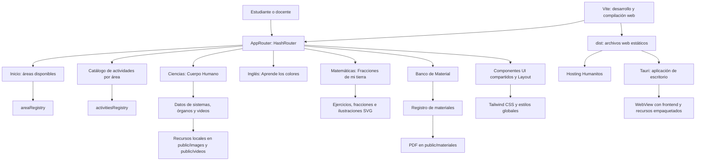

# AulaHumanitos

Aplicación educativa de la Fundación Humanitos para acercar actividades y recursos digitales a escuelas rurales de Norte de Santander. El mismo frontend React se compila como sitio web estático con Vite y se integra en una aplicación de escritorio con Tauri.

## 1. Descripción y alcance

### Propósito y contexto

AulaHumanitos ofrece un punto de acceso sencillo a actividades educativas para niños de primaria, de primero a quinto grado, y a materiales que apoyan el trabajo de sus docentes. El proyecto responde a las limitaciones de conectividad y de capacidad de los computadores en escuelas rurales: los contenidos de la aplicación se mantienen en el repositorio como recursos locales y la versión de escritorio puede ejecutarlos sin depender de un servicio remoto.

La interfaz organiza el acceso por áreas y actividades, ofrece navegación de regreso e inicio, y utiliza instrucciones visuales y controles interactivos. No requiere cuentas de usuario ni un servidor de datos para las funciones que están implementadas.

### Áreas y actividades

El catálogo de áreas está definido en `src/core/registry/areaRegistry.ts`; las actividades que se muestran dentro de cada área se registran en `src/core/registry/activitiesRegistry.ts`.

| Área | Estado en el código | Contenido implementado |
| --- | --- | --- |
| Ciencias Naturales | Disponible | **Cuerpo Humano**: navegación por los sistemas digestivo, respiratorio, circulatorio y nervioso; reproducción y búsqueda de videos por sistema; lista filtrable de 13 órganos con ilustración, descripción, función y, cuando existe, un dato curioso. |
| Inglés | Disponible | **Aprende los colores**: presenta el nombre de un color en inglés y cuatro opciones de color. Incluye selección aleatoria, retroalimentación para acierto o error, reintento, avance, indicador de progreso y reinicio tras recorrer los 11 colores configurados. |
| Matemáticas | Disponible | **Fracciones de mi tierra**: actividad visual de ocho ejercicios para identificar qué fracción está resaltada. Usa ilustraciones de duraznos de Cácota, fresas, uchuvas y parcelas campesinas; mezcla el orden de los ejercicios y las opciones en cada partida, ofrece retroalimentación y reintentos, lleva el puntaje y permite volver a jugar. |

#### Banco de Material

La sección está dirigida principalmente a docentes y se enlaza desde la pantalla de inicio. Presenta cinco documentos PDF locales: una presentación y una infografía de La Tiendita, clasificadas en Matemáticas, y tres guías de Humanitos clasificadas en Tecnología (digitalización, IA e Internet). Permite buscar por título y filtrar por materia y tipo de recurso (guía, presentación o infografía). Al abrir una tarjeta, el documento se abre en otra pestaña o ventana según el entorno.

Los datos de cada recurso (título, categoría, tipo y ruta) están en `src/material/data/materiales.ts`; los archivos se almacenan en `public/materiales/`. Las opciones de filtros se derivan de los recursos registrados.

### Modalidades de uso

- **Escritorio (Tauri):** la interfaz y los recursos de `public/` forman parte de la compilación local. Una vez instalada, la navegación y el contenido local implementado no dependen de Internet, sujeto a que el computador pueda reproducir los videos.
- **Web (Vite):** genera archivos estáticos en `dist/` para publicar en el hosting de Humanitos. El usuario accede al sitio a través del hosting.

El acceso offline se refiere a la versión de escritorio instalada y a sus recursos empaquetados. El frontend no consulta APIs o servicios remotos para cargar las actividades y materiales descritos aquí.

## 2. Arquitectura y tecnologías

### Arquitectura general

La aplicación está compuesta por un frontend de página única y un contenedor nativo opcional. La UI, navegación, contenido, estilos y recursos estáticos se construyen con tecnologías web. Tauri inicia una ventana WebView y carga el resultado del frontend; el código Rust actual configura el runtime y el plugin de apertura, pero no contiene la lógica pedagógica ni una capa de persistencia.



La navegación usa `HashRouter` (`src/core/router/AppRouter.tsx`), con rutas para inicio, Banco de Material, las tres actividades concretas y el catálogo `/:areaId`. La ruta de **Fracciones de mi tierra** es `/matematicas/fracciones-de-mi-tierra`. La ruta con hash permite la navegación dentro de la app de escritorio sin requerir que el protocolo local resuelva rutas del servidor. Las áreas y actividades se registran en datos TypeScript; las pantallas los consumen para construir sus tarjetas y estados vacíos.

### Tecnologías y responsabilidades

| Tecnología | Uso en el proyecto |
| --- | --- |
| React 19 y React DOM | Componentes, composición de pantallas y estado local de interacción. |
| TypeScript 6 | Tipos de áreas, actividades, órganos, sistemas y materiales; comprobación estática durante la compilación (`tsc`). |
| Vite 8 y `@vitejs/plugin-react` | Servidor de desarrollo y empaquetado del frontend para web y Tauri. La configuración fija el puerto de desarrollo en `1420`. |
| Tailwind CSS 4 y `@tailwindcss/vite` | Utilidades de estilo, tema de marca y diseño adaptable definidos principalmente en `src/index.css`. |
| `react-router-dom` | Enrutamiento del frontend mediante `HashRouter`, `Routes`, `Route`, `Link` y hooks de navegación. |
| `lucide-react` | Iconos de áreas, navegación, documentos y controles de interfaz. |
| Tauri 2 | Contenedor de escritorio, ventana WebView y generación de instaladores. `src-tauri/` contiene la configuración y el runtime Rust. |
| Rust, `tauri` y `tauri-plugin-opener` | Inicio del runtime Tauri y apertura de recursos externos. `src-tauri/src/lib.rs` aún incluye un comando de ejemplo `greet`; no implementa funciones educativas. |
| PDFs, imágenes, videos y fuentes WOFF2 | Recursos estáticos locales referenciados por las pantallas y los registros de contenido. |

Los scripts npm definidos actualmente son `dev` (Vite), `build` (`tsc && vite build`), `preview` (vista previa del `dist`) y `tauri` (CLI de Tauri). No se declara una herramienta de pruebas o lint en `package.json`.

### Organización de carpetas relevantes

```text
src/
  App.tsx                         Composición raíz: muestra AppRouter
  main.tsx                        Punto de entrada React e importación de estilos
  index.css                       Tailwind, fuentes y estilos globales
  assets/                         Logo, ilustración y fuentes WOFF2
  core/
    router/AppRouter.tsx          Rutas y desplazamiento al cambiar de página
    registry/                     Catálogos de áreas y actividades
    screens/                      Inicio y catálogo de actividades por área
    types/                        Tipos compartidos
    ui/                           Layout, tarjetas, estados vacíos y visuales
  areas/
    ciencias-naturales/            Actividad Cuerpo Humano, datos y componentes
    ingles/colores/                Actividad Aprende los colores
    matematicas/
      fracciones-de-mi-tierra/     Actividad, ejercicios e ilustraciones SVG
  material/
    BancoMaterial.tsx             Pantalla de búsqueda y filtros
    data/materiales.ts             Catálogo tipado de documentos
    components/MaterialCard.tsx    Enlace visual de cada documento
public/
  images/                          Previsualizaciones e ilustraciones de órganos
  videos/cuerpo-humano/            Videos MP4 por sistema y del cuerpo completo
  materiales/                      Documentos PDF del Banco de Material
src-tauri/
  src/main.rs                      Punto de entrada del ejecutable Rust
  src/lib.rs                       Configuración del runtime Tauri
  tauri.conf.json                  Ventana, comandos de build y recursos frontend
  capabilities/default.json        Permisos de la ventana principal
```

### Componentes y módulos principales

- `HomeScreen` muestra las tarjetas de áreas desde `areaRegistry` y el acceso al Banco de Material.
- `AreaCard` presenta el estado disponible/no disponible. `AreaActivities` obtiene el área y sus actividades de los registros; si el área no tiene actividades, muestra `EmptyState`.
- `Layout` mantiene el encabezado con logo, navegación volver/inicio, contenido central y pie de página compartidos.
- `ModeloCuerpo` coordina el filtro de sistema y la selección de órgano. `SystemFilters`, `OrganList`, `OrganInfoPanel` y `BodyVideo` separan controles, selección, contenido descriptivo y reproducción.
- `AprendeColores` administra el orden aleatorio, las opciones, los aciertos, errores, reintentos y progreso con estado React local.
- `FraccionesDeMiTierra` presenta ocho ejercicios con cuatro opciones visuales de fracción, retroalimentación, reintento, avance, puntaje final y reinicio. `datos.ts` define los ejercicios y mezcla su orden y el de las opciones en cada partida; `Ilustraciones.tsx` dibuja duraznos, canastas de fresas y uchuvas, y parcelas mediante SVG.
- `BancoMaterial` calcula los filtros a partir del catálogo, aplica búsqueda por título y filtros por materia y tipo, y representa cada resultado con `MaterialCard`.

### Contenidos y recursos multimedia

Los datos pedagógicos están declarados en TypeScript junto a cada módulo: `sistemas.ts`, `organos.ts` y `videos.ts` para Ciencias; constantes locales en `AprendeColores.tsx` para Inglés; `datos.ts` e `Ilustraciones.tsx` para Fracciones de mi tierra; y `materiales.ts` para los documentos. No hay CMS ni base de datos en el código examinado. Para añadir un recurso al Banco se copia el archivo a `public/materiales/` y se registra su ruta `/materiales/...` en `materiales.ts`. Para añadir una actividad se crea su pantalla, se registra una ruta en `AppRouter.tsx` y se agrega al área correspondiente en `activitiesRegistry.ts`.

Las imágenes y videos de Ciencias se referencian con rutas bajo `/images/cuerpo-humano/` y `/videos/cuerpo-humano/`. `BodyVideo` carga el archivo MP4 local con `fetch`, crea una URL `blob:` para permitir búsqueda dentro del video y ofrece reproducción, pausa, control de posición y pantalla completa. Esto implica cargar el video seleccionado en memoria; conviene considerar el tamaño de los medios al preparar nuevas versiones para computadores con recursos limitados. Los activos actuales incluyen cinco MP4, además de imágenes y cinco PDF.

### Desarrollo, compilación y distribución

Se requiere Node.js/npm para el frontend. Para compilar o ejecutar la aplicación de escritorio también se requieren las dependencias y herramientas de desarrollo de Tauri 2 y Rust correspondientes al sistema operativo destino.

```bash
# Desarrollo web con Vite (http://localhost:5173 por defecto)
npm install
npm run dev

# Compilación web: verifica TypeScript y genera dist/
npm run build

# Servir localmente el resultado de dist/
npm run preview

# Desarrollo de escritorio con Tauri; usa Vite en el puerto configurado 1420
npm run tauri -- dev

# Crear instaladores de escritorio para la plataforma configurada
npm run tauri -- build
```

En el modo de escritorio, `src-tauri/tauri.conf.json` ejecuta `npm run dev` antes de `tauri dev`, y `npm run build` antes de empaquetar; `frontendDist: "../dist"` indica que la aplicación Tauri carga el frontend compilado. El archivo de configuración especifica una ventana inicial de 800 × 600 y permite generar los formatos de bundle compatibles con la plataforma.

Para desplegar la versión web, se publica el contenido generado en `dist/` en el hosting de Humanitos. Dado que el enrutador usa fragmentos (`#`), el servidor estático no necesita reglas de reescritura para las rutas internas de la aplicación. Las rutas de archivos públicos comienzan con `/`; si se publica bajo un subdirectorio en vez de la raíz del dominio, habría que revisar la configuración de `base` de Vite y las rutas absolutas de recursos antes de desplegar.
